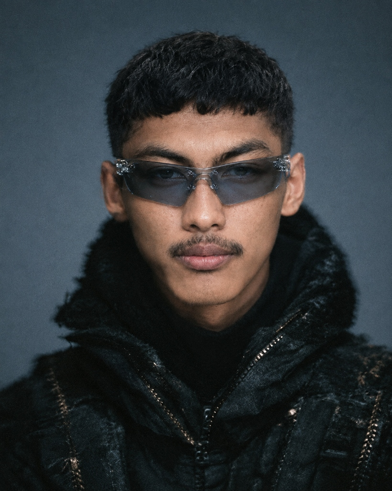

<p align="center">
  
</p>

<p align="center">
  <a href="https://github.com/web-personal13">
    
  </a>
</p>

<div align="center">

|  | <div align="left"><h3>👋 About Me</h3><p>I am a passionate Mobile Application Developer specializing in <b>Flutter & Dart</b>.<br>I love building beautiful, intuitive, and highly functional mobile applications with focus on smooth user experience, offline-first reliability, and clean architecture.</p><p>🚀 Currently building next-generation productivity & utility mobile apps.<br>💡 Always exploring cutting-edge mobile technologies & reactive architecture.</p></div> |
| :---: | :--- |

</div>

---

### 🕹️ Retro Arcade Gamer Profile

```yaml
Character: Yuko
Class    : Mobile App Sorcerer 🧙‍♂️
Level    : 99
HP       : [████████████████████] 100% (Fueled by Caffeine ☕)
Mana     : [████████████████████] 100% (Clean Architecture Power ⚡)
Specialty: Flutter, Dart, Offline Persistence, OCR & Reactive UI
Quest    : Crafting world-class mobile experiences
```

<details>
<summary>🎮 <b>[CLICK TO PLAY] Interactive Easter Egg Terminal Mini-Game!</b></summary>
<br>

```text
> INITIALIZING YUKO_OS_V2.0...
> Choose your developer path:
  [A] Build high-performance offline Flutter apps with local storage
  [B] Craft pixel-perfect animations & dynamic charts
  [C] Integrate machine learning OCR & media extraction
> SYSTEM RESPONSE: Why choose? YUKO does ALL of them with style! 🚀
```

</details>

---

### 📈 Activity & Contribution Matrix

<p align="center">
  
</p>

---

### 🚀 Featured Portfolios & Projects

<div align="center">

| Project | Description | Tech Stack | Status |
| :--- | :--- | :---: | :---: |
| 💰 **[Dompi - Pencatat Keuangan](https://github.com/web-personal13/pencatat-keuangan)** | Modern offline-first personal financial manager with ML Kit OCR receipt scanner, interactive charts, and Excel export. | `Flutter` `Dart` `ML Kit` `fl_chart` | 🌟 Active |
| 📥 **[Savely - Media Downloader](https://github.com/web-personal13/savely-app)** | Fast, aesthetic social media video & image extractor with dark mode UI, download queue, and direct gallery sync. | `Flutter` `Dart` `Dio` `Gal` | 🌟 Active |

</div>

---

### 🛠️ Tech Stack & Arsenal

<p align="center">
  
  
  
  
  
  
  <br>
  
  
  
  
  
</p>

---

### 📊 GitHub Activity & Metrics

<p align="center">
  
  
</p>

<p align="center">
  
</p>

---

<p align="center">
  
</p>
